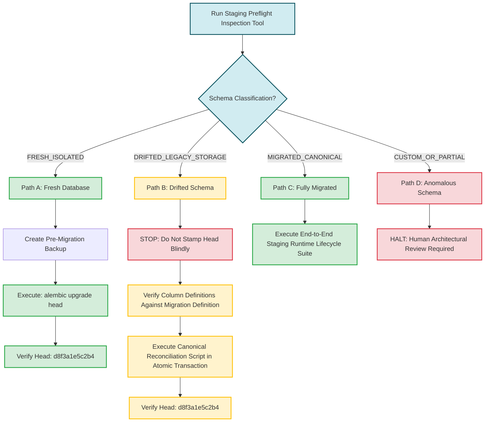

# Automind — Task 6D: Remote Staging Preflight Preparation & Tooling

**Repository:** `C:\Users\ARKAN STOER\Desktop\777`  
**Branch:** `main`  
**Audit Date:** 2026-10-18T23:14:00+03:00  
**Status:** TOOLING COMPLETE / ZERO REMOTE WRITES / LOCAL TESTS PASS (71/71) / PRODUCTION UNTOUCHED

---

## 1. Executive Summary & Operational Boundary Confirmation

> [!IMPORTANT]
> **Operational Boundary Declaration**:
> 1. **Zero Remote Writes**: This task performed zero database modifications, zero remote migrations, and zero cloud provisioning operations.
> 2. **Zero Production Connections**: No connection was attempted or established to production reference `ccejhzadokkjssjiwmxt` or any live production host.
> 3. **Preserved Runtime DDL Fallback**: Lines 95–142 in `backend/app/services/postgres_storage_provider.py` remain intact and unchanged.
> 4. **Read-Only Inspection Guarantee**: The new preflight tool issues `SET TRANSACTION READ ONLY;` immediately upon opening a connection, ensuring the PostgreSQL server engine itself rejects any write or DDL attempt.

---

## 2. Preflight Tool Architecture & Security Design

The read-only preflight inspection tool is implemented in:
- [`backend/app/core/staging_preflight.py`](file:///c:/Users/ARKAN%20STOER/Desktop/777/backend/app/core/staging_preflight.py) (178 lines, Rule 11 compliant)
- [`backend/app/core/staging_preflight_queries.py`](file:///c:/Users/ARKAN%20STOER/Desktop/777/backend/app/core/staging_preflight_queries.py) (75 lines, Rule 11 compliant)

### Multi-Layer Security Architecture:
```
[ Operator Input: STAGING_DATABASE_URL ]
                 │
                 ▼
[ Layer 1: Environment Marker Check ]
  Is ENVIRONMENT == "staging"? ─── No ──► [ FAIL CLOSED: RuntimeError ]
                 │ Yes
                 ▼
[ Layer 2: Operator Intent Confirmation ]
  Is CONFIRM_READONLY_STAGING_PREFLIGHT == "true"? ─── No ──► [ FAIL CLOSED: RuntimeError ]
                 │ Yes
                 ▼
[ Layer 3: Production Reference Check ]
  Does URL/host/db contain "ccejhzadokkjssjiwmxt"? ─── Yes ──► [ FAIL CLOSED: RuntimeError ]
                 │ No
                 ▼
[ Layer 4: Credential Redaction ]
  Strip username & password -> Form sanitized endpoint string
                 │
                 ▼
[ Layer 5: PostgreSQL Engine Read-Only Mode ]
  Execute "SET TRANSACTION READ ONLY;"
                 │
                 ▼
[ Layer 6: System Catalog Introspection Only ]
  Query information_schema, pg_class, pg_policies, pg_indexes
```

---

## 3. Preflight Tool Usage & Secure Environment Setup

### 3.1 Operator Setup Commands
In the staging shell session (do NOT commit connection strings to `.env` or repository files):
```powershell
# 1. Export staging connection URL
$env:STAGING_DATABASE_URL = "postgresql+asyncpg://<staging_user>:<staging_password>@<staging_host>:<staging_port>/<staging_db>"

# 2. Set explicit environment marker
$env:ENVIRONMENT = "staging"

# 3. Explicit operator confirmation of read-only intent
$env:CONFIRM_READONLY_STAGING_PREFLIGHT = "true"

# 4. Set Python path
$env:PYTHONPATH = "c:\Users\ARKAN STOER\Desktop\777\backend"
```

### 3.2 Execution Command
```powershell
python -m app.core.staging_preflight
```

---

## 4. Expected Output & Fail-Closed Scenarios

### 4.1 Expected Success Output (Sample from Local Staging Test)
```text
============================================================
  AUTOMIND REMOTE STAGING READ-ONLY PREFLIGHT REPORT
============================================================
Target Endpoint (Sanitized): postgresql+asyncpg://localhost:5434/automind_staging
Database Name:               automind_staging
Server Host:Port:            localhost:5434
Server PostgreSQL Version:   PostgreSQL 15.18 (Debian 15.18-1.pgdg13+1)...
Alembic Version Table:       PRESENT
Current Alembic Revision:    d8f3a1e5c2b4
Schema Classification:       MIGRATED_CANONICAL
------------------------------------------------------------
Target Migration Tables Inspection:

[Table: business_context]
  Status:        EXISTS (17 columns)
  RLS Enabled:   True (Forced: False)
  RLS Policies:  0 active
  Indexes:       5
  Constraints:   9
  Columns:
    - id: uuid (nullable=NO, default=None)
    - project_id: uuid (nullable=NO, default=None)
    - context_type: character varying (nullable=NO, default=None)
    - context_key: character varying (nullable=NO, default=None)
    - title: character varying (nullable=NO, default=None)
    - content: text (nullable=NO, default=None)
    - tags: jsonb (nullable=YES, default='[]'::jsonb)
    - relevance_score: double precision (nullable=YES, default=1.0)
    - times_used: integer (nullable=YES, default=0)
    - learned_from: character varying (nullable=YES, default=None)
    - confidence_score: double precision (nullable=YES, default=0.5)
    - active_for_platforms: jsonb (nullable=YES, default='[]'::jsonb)
    - examples: jsonb (nullable=YES, default='[]'::jsonb)
    - is_active: boolean (nullable=YES, default=true)
    - last_used: timestamp with time zone (nullable=YES, default=None)
    - created_at: timestamp with time zone (nullable=NO, default=now())
    - updated_at: timestamp with time zone (nullable=YES, default=None)

[Table: product_images]
  Status:        EXISTS (7 columns)
  RLS Enabled:   True (Forced: False)
  RLS Policies:  0 active
  Indexes:       2
  Constraints:   7
  Columns:
    - key: character varying (nullable=NO, default=None)
    - project_id: uuid (nullable=YES, default=None)
    - data: bytea (nullable=NO, default=None)
    - content_type: character varying (nullable=NO, default=None)
    - size: integer (nullable=NO, default=None)
    - created_at: timestamp with time zone (nullable=NO, default=now())
    - updated_at: timestamp with time zone (nullable=YES, default=None)
============================================================
```

### 4.2 Verified Fail-Closed Scenarios
1. **Unset Environment Marker**:
   ```text
   [PREFLIGHT ERROR] FAIL CLOSED: ENVIRONMENT must be explicitly set to 'staging' (current: 'UNSET').
   ```
2. **Missing Operator Intent Confirmation**:
   ```text
   [PREFLIGHT ERROR] FAIL CLOSED: CONFIRM_READONLY_STAGING_PREFLIGHT must be explicitly set to 'true'.
   ```
3. **Production URL Detected**:
   ```text
   [PREFLIGHT ERROR] FAIL CLOSED: Target matches production Supabase reference (ccejhzadokkjssjiwmxt). Connecting to production from preflight is strictly prohibited.
   ```

---

## 5. Backup & Restore Prerequisites Before Any Migration

Before applying any schema change or migration to a remote staging database:
1. **Physical / Logical Backup**:
   - If using Supabase: Create a point-in-time recovery (PITR) backup snapshot via Supabase dashboard.
   - If using standalone PostgreSQL: Execute:
     ```bash
     pg_dump -h "$STAGING_HOST" -p "$STAGING_PORT" -U "$STAGING_USER" -d "$STAGING_DB" -Fc -f "staging_pre_migration_backup.dump"
     ```
2. **Rollback Verification**:
   - Ensure the operator has database owner privileges and knows the exact restore command:
     ```bash
     pg_restore --clean --if-exists -h "$STAGING_HOST" -p "$STAGING_PORT" -U "$STAGING_USER" -d "$STAGING_DB" "staging_pre_migration_backup.dump"
     ```

---

## 6. Fresh vs. Drifted Schema Decision Tree



---

## 7. Operator Approval Gate Before Future Remote Migrations

No remote database command may be run until the following gate conditions are met:
- [ ] Dedicated remote staging instance provisioned (not production).
- [ ] `python -m app.core.staging_preflight` executed and report generated.
- [ ] Output reviewed by engineering lead.
- [ ] Staging database backup completed and verified.
- [ ] Explicit human operator approval signed off in ticket/PR.

---

## 8. Verification & Test Evidence

All unit and integration tests for the preflight tool and core system passed against the local isolated PostgreSQL test database:

```powershell
python -m pytest `
    tests/test_project_creation_regression.py `
    tests/test_project_deletion_safety.py `
    tests/test_projects_security.py `
    tests/test_database_guard.py `
    tests/test_database_routing.py `
    tests/test_alembic_isolation.py `
    tests/test_migration_authorization.py `
    tests/test_staging_preflight.py `
    -v
```

**Results**: **71 passed, 0 failed, 26 warnings in 24.29s**
- `tests/test_staging_preflight.py`: 5 passed in 0.57s
  - `test_preflight_fails_without_staging_env`: PASSED
  - `test_preflight_fails_without_operator_confirmation`: PASSED
  - `test_preflight_fails_on_missing_url`: PASSED
  - `test_preflight_fails_closed_on_production_url`: PASSED
  - `test_preflight_read_only_inspection_success`: PASSED
- `git diff --check`: Exit code 0 (zero whitespace or format defects).
