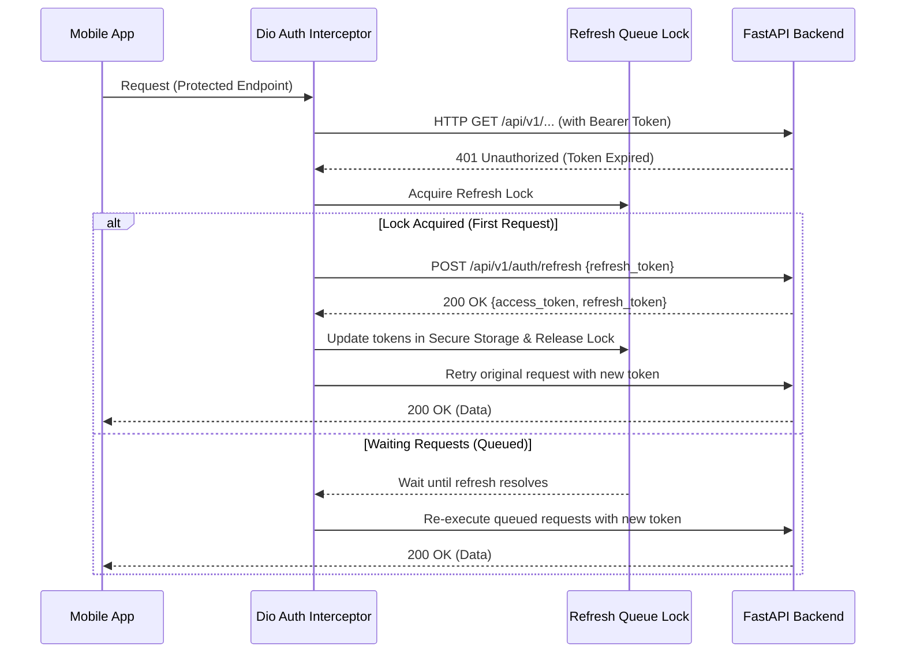
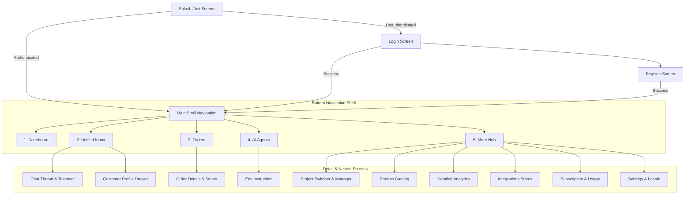

# Automind Mobile — Flutter Android Application Implementation Plan
**Document Version:** 1.0.0  
**Target Platform:** Android (Material 3, Min SDK 24, Target SDK 34/35)  
**State Architecture:** Flutter 3.44+ / Dart 3.12+, Riverpod, GoRouter, Dio, Secure Storage  

---

## 1. Executive Summary & Objective

Automind is a multi-tenant, AI-powered sales automation and customer communication SaaS platform. The mobile application extends Automind to Android devices, serving as an operational mobile control center for business owners and authorized team members.

### Core Objectives:
1. **Direct Backend Integration**: Connect directly to the production FastAPI backend via secure HTTPS endpoints and WebSockets (`/ws/{project_id}`), avoiding mock or intermediate proxy layers.
2. **Multi-Tenant Workspace Context**: Provide project switching with tenant isolation. Active project context is validated against backend authorization and prevents cross-tenant data leaks.
3. **Operational Core Flows**:
   - Real-time Unified Inbox with human takeover toggle (`/toggle-ai`) and message composition.
   - Live Dashboard powered by tenant-scoped summary metrics (`/dashboard-summary`).
   - Order management with real-time lifecycle tracking and status transitions.
   - AI agent configuration and instruction management (`/bot-training/instructions`).
   - Catalog management (products), customer profiles, integrations status, and billing metrics.
4. **Production Architecture**:
   - Built on **Riverpod** (state management & dependency injection), **GoRouter** (declarative routing with auth and tenant guards), **Dio** (interceptors, token refresh lock, exponential backoff), and **flutter_secure_storage** (hardware-backed encrypted token persistence).
   - Strict adherence to the 250-line rule per file via modular encapsulation.
   - Dual-locale support: English (LTR) and Arabic (RTL) with localized typography and numeral formatting.

---

## 2. Existing Backend Architecture & Verified API Inventory

The Automind backend is built with **FastAPI**, **SQLAlchemy (Async)**, and **PostgreSQL**, with Redis caching and Celery workers for asynchronous automation.

### 2.1 Verified API Inventory

| Domain | Method | Endpoint | Auth | Verified Request / Response Schema |
|---|---|---|---|---|
| **Health** | `GET` | `/health` | Public | Status & UTC timestamp |
| **Auth** | `POST` | `/api/v1/auth/login` | Public | Req: `UserLogin(email, password)`<br/>Res: `TokenResponse(access_token, refresh_token, token_type, expires_in)` |
| **Auth** | `POST` | `/api/v1/auth/register` | Public | Req: `UserRegister(email, password, name)`<br/>Res: `UserResponse(id, email, name, role, is_active)` |
| **Auth** | `POST` | `/api/v1/auth/refresh` | Public/Bearer | Req: `RefreshTokenRequest(refresh_token)`<br/>Res: `TokenResponse(access_token, refresh_token, expires_in)` |
| **Auth** | `POST` | `/api/v1/auth/logout` | Bearer | Req: `{refresh_token}` (optional in body or cookie)<br/>Res: `{"message": "Logged out successfully"}` |
| **Auth** | `GET` | `/api/v1/auth/me` | Bearer | Res: `UserResponse(id, email, name, role, is_active, created_at, last_login)` |
| **Projects** | `GET` | `/api/v1/projects` | Bearer | Res: `List[ProjectResponse]` |
| **Projects** | `POST` | `/api/v1/projects` | Bearer | Req: `ProjectCreate(name, description, ...)`<br/>Res: `ProjectResponse` |
| **Projects** | `GET` | `/api/v1/projects/{project_id}` | Bearer (Tenant) | Res: `ProjectResponse` |
| **Projects** | `PATCH` | `/api/v1/projects/{project_id}` | Bearer (Tenant) | Req: `ProjectUpdate`<br/>Res: `ProjectResponse` |
| **Projects** | `GET` | `/api/v1/projects/{project_id}/members` | Bearer (Tenant) | Res: `List[ProjectMemberResponse]` |
| **Messages / Inbox** | `GET` | `/api/v1/messages/{project_id}/conversations` | Bearer (Tenant) | Res: `List[ConversationSummary]` (includes `ai_enabled`, `unread_count`, `customer_name`, `channel`, etc.) |
| **Messages / Inbox** | `GET` | `/api/v1/messages/{project_id}/conversations/{conversation_id}/messages` | Bearer (Tenant) | Res: `List[ConversationMessage]` |
| **Messages / Inbox** | `POST` | `/api/v1/messages/{project_id}/send` | Bearer (Tenant) | Req: `MessageSend(recipient, content, provider, ...)`<br/>Res: `MessageResponse` |
| **Messages / Takeover** | `PATCH` | `/api/v1/messages/{project_id}/customers/{profile_id}/toggle-ai` | Bearer (Tenant) | Query: `enabled: bool`<br/>Res: Updated AI state |
| **Messages** | `PATCH` | `/api/v1/messages/{project_id}/conversations/{conversation_id}/read` | Bearer (Tenant) | Res: `{"status": "ok"}` |
| **Customers** | `GET` | `/api/v1/messages/{project_id}/customers/{profile_id}` | Bearer (Tenant) | Res: `CustomerProfileResponse` |
| **Realtime** | `WS` | `/ws/{project_id}` | Public/Query | Broadcast: `{"type": "new_message", "message": {...}}` |
| **Orders** | `GET` | `/api/v1/orders/{project_id}` | Bearer (Tenant) | Res: `List[OrderResponse]` |
| **Orders** | `GET` | `/api/v1/orders/{project_id}/{order_id}` | Bearer (Tenant) | Res: `OrderResponse` |
| **Orders** | `PATCH` | `/api/v1/orders/{project_id}/{order_id}` | Bearer (Tenant) | Req: `OrderUpdate(status, items, total, ...)`<br/>Res: `OrderResponse` |
| **Order Management** | `GET` | `/api/v1/order-management/{project_id}/orders/requiring-attention` | Bearer (Tenant) | Res: Orders list requiring action |
| **Dashboard / Analytics** | `GET` | `/api/v1/reports/{project_id}/dashboard-summary` | Bearer (Tenant) | Res: Period summaries (`today`, `yesterday`, `this_week`, `this_month`) with orders, revenue, messages, escalations, meta stats |
| **AI Bot Training** | `GET` | `/api/v1/bot-training/{project_id}/instructions` | Bearer (Tenant) | Res: `List[BotInstruction]` |
| **AI Bot Training** | `POST` | `/api/v1/bot-training/{project_id}/instructions` | Bearer (Tenant) | Req: `BotInstructionCreate`<br/>Res: `BotInstruction` |
| **AI Bot Training** | `PUT` | `/api/v1/bot-training/{project_id}/instructions/{id}` | Bearer (Tenant) | Req: `BotInstructionUpdate`<br/>Res: `BotInstruction` |
| **AI Bot Training** | `DELETE` | `/api/v1/bot-training/{project_id}/instructions/{id}` | Bearer (Tenant) | Res: 204 No Content |
| **Products** | `GET` | `/api/v1/products/{project_id}` | Bearer (Tenant) | Res: `List[ProductResponse]` |
| **Products** | `POST` | `/api/v1/products/{project_id}` | Bearer (Tenant) | Req: `ProductCreate`<br/>Res: `ProductResponse` |
| **Products** | `GET` | `/api/v1/products/{project_id}/{product_id}` | Bearer (Tenant) | Res: `ProductResponse` |
| **Products** | `PUT` | `/api/v1/products/{project_id}/{product_id}` | Bearer (Tenant) | Req: `ProductUpdate`<br/>Res: `ProductResponse` |
| **Products** | `DELETE` | `/api/v1/products/{project_id}/{product_id}` | Bearer (Tenant) | Res: 204 No Content |
| **Integrations** | `GET` | `/api/v1/integrations/{project_id}` | Bearer (Tenant) | Res: `List[IntegrationResponse]` |
| **Subscriptions** | `GET` | `/api/v1/subscriptions/my-subscription` | Bearer | Res: Subscription details and current tier |
| **Subscriptions** | `GET` | `/api/v1/subscriptions/usage` | Bearer | Res: Usage metrics |

---

## 3. Authentication & Token Management Flow

### 3.1 Token Strategy
- **Access Token**: JWT containing `{sub: user_id, email, role}`. Expires in 60 minutes. Delivered in Authorization header: `Bearer <token>`.
- **Refresh Token**: High-entropy cryptographically secure token stored in PostgreSQL `refresh_tokens` table. Expired/revoked on rotation.
- **Hardware-Backed Storage**: On Android, stored using `flutter_secure_storage` utilizing Android Keystore AES encryption.

### 3.2 Token Refresh & Race Prevention


---

## 4. Visual Identity & Design System Specification

Adhering strictly to Automind's visual identity defined in `docs/design-system/visual-identity.md`:

### 4.1 Canonical Colors
- **Brand Primary**: `#0ea5e9` (Sky 500)
- **Brand Hover / Active**: `#0284c7` (Sky 600)
- **Brand Glow**: `rgba(14, 165, 233, 0.20)`
- **Background Root (Dark)**: `#020617` (Slate 950)
- **Surface Layer 1**: `rgba(15, 23, 42, 0.85)` (Slate 900 Glass)
- **Surface Elevated Layer 2**: `rgba(30, 41, 59, 0.90)` (Slate 800)
- **Text Primary**: `#f8fafc` (Slate 50)
- **Text Secondary**: `#94a3b8` (Slate 400)
- **Text Muted**: `#64748b` (Slate 500)
- **Borders**: `rgba(255, 255, 255, 0.08)`
- **Success**: `#10b981` (Emerald 500)
- **Warning**: `#f59e0b` (Amber 500)
- **Danger**: `#f43f5e` (Rose 500)

### 4.2 Typography & Numerals
- Font family: Inter (Latin) with Noto Sans Arabic fallback for RTL.
- High-contrast tabular numerals for currency and metrics.
- Touch target standard: minimum $48 \times 48\text{ dp}$ per Android Material 3 guidelines.

---

## 5. Mobile Navigation & Screen Architecture



---

## 6. Target Directory & Package Structure (Strict <=250 LOC / file)

```
android/
├── pubspec.yaml
├── lib/
│   ├── main.dart
│   ├── app.dart
│   ├── core/
│   │   ├── config/ (app_config.dart, env_config.dart)
│   │   ├── network/ (api_client.dart, api_endpoints.dart, auth_interceptor.dart, exceptions.dart)
│   │   ├── storage/ (secure_storage_service.dart)
│   │   ├── theme/ (app_colors.dart, app_typography.dart, app_theme.dart)
│   │   ├── routing/ (app_router.dart, route_guards.dart)
│   │   ├── localization/ (app_localizations.dart, strings_en.dart, strings_ar.dart)
│   │   └── websocket/ (websocket_client.dart, ws_event_handler.dart)
│   ├── shared/
│   │   ├── widgets/ (app_button.dart, app_text_field.dart, glass_card.dart, status_badge.dart, error_view.dart, empty_view.dart, skeleton_loader.dart)
│   │   └── utils/ (formatters.dart, validators.dart)
│   └── features/
│       ├── auth/ (models, providers, screens: login, register)
│       ├── projects/ (models, providers, widgets: project_selector_sheet)
│       ├── dashboard/ (models, providers, screens: dashboard_screen, widgets: metric_card, activity_tile)
│       ├── inbox/ (models, providers, screens: inbox_screen, chat_screen, widgets: chat_bubble, takeover_banner, message_input)
│       ├── orders/ (models, providers, screens: orders_screen, order_detail_screen, widgets: order_card, status_dialog)
│       ├── agents/ (models, providers, screens: agents_screen, edit_instruction_screen)
│       ├── products/ (models, providers, screens: products_screen, edit_product_screen)
│       ├── customers/ (models, providers, screens: customer_profile_sheet)
│       ├── analytics/ (models, providers, screens: analytics_screen)
│       ├── integrations/ (models, providers, screens: integrations_screen)
│       ├── billing/ (models, providers, screens: billing_screen)
│       └── settings/ (models, providers, screens: settings_screen)
└── test/
    ├── unit/ (auth_test, token_refresh_test, project_context_test, api_error_test)
    └── widget/ (login_screen_test, dashboard_test, chat_bubble_test)
```

---

## 7. Phased Implementation Strategy & Acceptance Criteria

### Phase 1 — Project Configuration & Dependencies Upgrade
- Clean legacy prototype dependencies in `android/pubspec.yaml`.
- Introduce official production dependencies:
  - `flutter_riverpod: ^2.6.1`
  - `go_router: ^14.8.1`
  - `dio: ^5.8.0+1`
  - `flutter_secure_storage: ^9.2.4`
  - `web_socket_channel: ^3.0.3`
  - `intl: ^0.20.2`
  - `cached_network_image: ^3.4.1`
- Establish Android application identity: `online.automio.app` / `Automind`.

### Phase 2 — Core Network, Security & Token Interceptors
- Build `ApiClient` with Dio, `AuthInterceptor` with automated mutex token refresh.
- Implement hardware-encrypted `SecureStorageService`.
- Implement centralized error mapper converting HTTP 401, 403, 404, 422, 500 to localized user-friendly exceptions.
- Implement Riverpod auth and project providers.

### Phase 3 — Design System, Theme Tokens & Localization Infrastructure
- Implement `AppColors`, `AppTypography`, `AppTheme` adhering to Automind brand guidelines.
- Build reusable UI primitives: `AppButton`, `GlassCard`, `StatusBadge`, `AppTextField`, `SkeletonLoader`, `EmptyView`, `ErrorView`.
- Build English and Arabic localization dictionaries with full RTL support.

### Phase 4 — Authentication & Tenant Project Selection
- Implement Splash screen with session auto-restore.
- Implement Sign-in and Sign-out screens with validation.
- Implement Tenant context selector bottom sheet; enforce project cache isolation on project change.

### Phase 5 — Core Workflows (Dashboard, Inbox & Orders)
- **Dashboard**: Pull-to-refresh, real metric cards (`/dashboard-summary`), time period selector.
- **Unified Inbox**: Conversation listing, real-time WebSocket updates, message thread, message composition, and **AI Takeover toggle** (`/toggle-ai`).
- **Orders**: Orders list, status filters, order detail view, status update transitions.

### Phase 6 — Extended SaaS Capabilities
- **AI Agents**: Bot instructions listing, creation, and editing (`/bot-training/instructions`).
- **Products**: Catalog listing, stock indicators, product creation/updating.
- **Integrations & Billing**: Channel status view (WhatsApp QR indicator, Meta status), subscription limits & usage.
- **Settings**: Theme switcher, Language switcher (English/Arabic), user profile & logout.

### Phase 7 — Verification, Quality Assurance & Build
- Static analysis: `dart format`, `flutter analyze` with 0 warnings/errors.
- Automated tests: Unit tests for auth, refresh lock, formatters, and widget tests.
- APK compilation verification: `flutter build apk --debug`.

---

## 8. Verification & Sign-Off Checklist

Before proceeding to alter file architecture, explicit user sign-off is required as mandated by rule 14.
- [x] Verified existing backend routes and schemas against codebase.
- [x] Identified design tokens and official SVG logos.
- [x] Documented missing endpoints (e.g. standalone customer list endpoint is absent; customer data is aggregated via conversations/messages/orders).
- [x] Established strict <=250 LOC architecture plan.
- [ ] Explicit user sign-off to proceed with Phase 1-7 execution.
